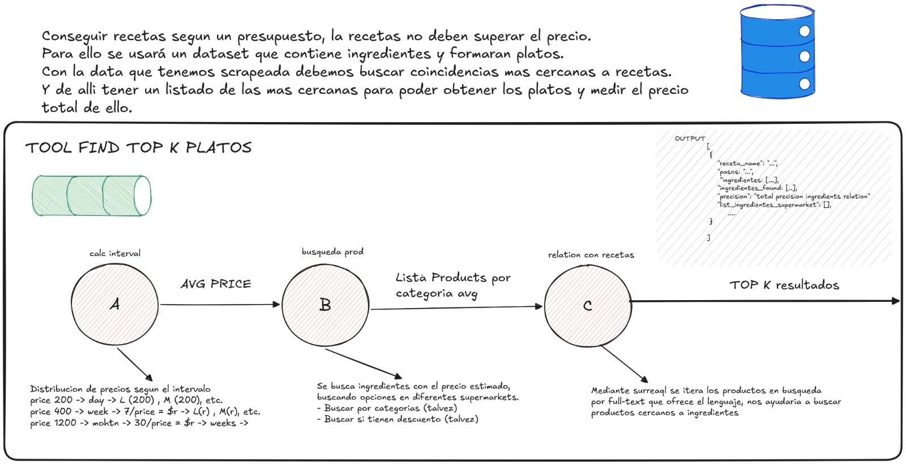

# Procompras

Motor para planificar almuerzos según el presupuesto y las preferencias de cada
usuario, considerando la compra real de productos, presentaciones y envío.

## Estructura

```text
procompras/
├── JavaProcompras/          # Backend Java y proyecto Maven
│   ├── pom.xml
│   └── src/
├── notebook/               # Análisis y preparación de recetas
│   ├── 01_limpieza_recetas.ipynb
│   ├── requirements.txt
│   ├── mise.toml
│   └── data/
│       ├── processed/
│       └── reports/
├── docker-compose.yaml     # PostgreSQL para desarrollo
└── README.md
```

El módulo móvil se incorporará posteriormente como otra carpeta de este repositorio.
Cada módulo mantiene su entorno y sus dependencias.

## Backend

Requiere Java 21 y Maven. Desde la raíz:

```powershell
mvn -f .\JavaProcompras\pom.xml test
```

Configuración y ejecución: [JavaProcompras/README.md](JavaProcompras/README.md).

## Análisis de recetas

[Notebook de limpieza](notebook/01_limpieza_recetas.ipynb) y
[comandos de instalación y ejecución](notebook/README.md).

El dataset original permanece en
`JavaProcompras/src/main/resources/datasets/recetasdelaabuela.csv`.
El notebook lo lee sin modificarlo y exporta a `notebook/data`.

## PostgreSQL local

```powershell
docker compose up -d postgres
```

La configuración conserva el nombre del proyecto Compose anterior para mantener
la referencia al volumen de desarrollo al cambiar el nombre de la carpeta.

## Diseño inicial


